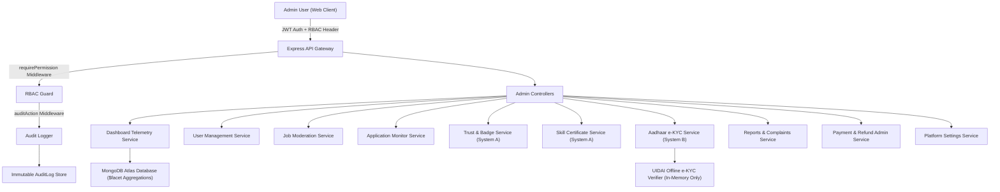

# AgriConnect Admin Control Center & Telemetry Architecture

## Executive Overview

The **AgriConnect Admin Architecture** provides real-time system operational telemetry, granular administrative role-based access control (RBAC), Dual-Verification workflows (System A Trust & System B Aadhaar e-KYC), content moderation, financial oversight, immutable security audit trails, and dynamic platform configuration.

---

## High-Level System Architecture

---

## Architectural Principles

1. **Dual-Verification Decoupling**:
   - **System A (Trust & Skill Verification)**: Evaluates platform activity, profile completeness, user ratings, completed work history, and agricultural skill certificates. Produces a 0–100 Trust Score and dynamic trust levels (`BASIC`, `VERIFIED`, `SKILLED`, `TRUSTED`, `TOP_RATED`).
   - **System B (Identity Verification)**: Processes UIDAI Paperless Offline e-KYC ZIP files in-memory to verify user identity. Issues the `IDENTITY_VERIFIED` badge.
   - **CRITICAL**: System A Trust Score is **NOT** a government identity verification metric.

2. **Least Privilege & Role Isolation**:
   - Administrative endpoints strictly enforce granular permission checks (e.g., `users.read`, `jobs.moderate`, `verification.review`, `refunds.manage`).

3. **Data Minimization & Zero Secrets Storage**:
   - Aadhaar numbers, Share Codes, OTPs, biometrics, and raw XML are **never stored** in the database or log files.
   - API secrets, Razorpay keys, and JWT secrets remain strictly isolated in environment variables (`.env`).

4. **Telemetry Caching & Performance**:
   - High-throughput admin dashboards use single-pass MongoDB `$facet` aggregation pipelines combined with a 30-second TTL in-memory cache to prevent database load spikes.
