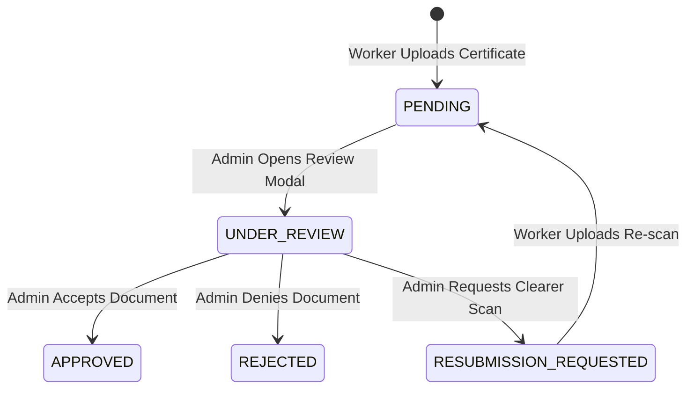

# System A: Skill Certificate Verification Workflow

## Overview

Agricultural workers upload training certificates, tractor driving licenses, equipment operator credentials, and ITI diplomas to verify their practical skills on AgriConnect.

---

## State Lifecycle

---

## Certificate Statuses

1. **`PENDING`**: Initial submission awaiting administrative verification officer review.
2. **`APPROVED`**: Certificate validated. Awards `SKILL_VERIFIED` badge (+20 Trust Score points).
3. **`REJECTED`**: Certificate rejected due to invalid metadata or unreadable scan.
4. **`RESUBMISSION_REQUESTED`**: Worker prompted to re-upload a higher quality document.

---

## Document Access Privacy

- **Private Document Endpoint**: `getCertificateDocumentSecure` validates that only the owner or an authorized verification admin can view raw document paths.
- **Audit Logging**: Every document access logs an immutable audit event (`PRIVATE_CERTIFICATE_DOCUMENT_ACCESSED`) with IP address and timestamp.
