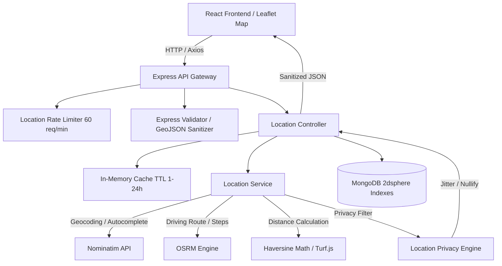
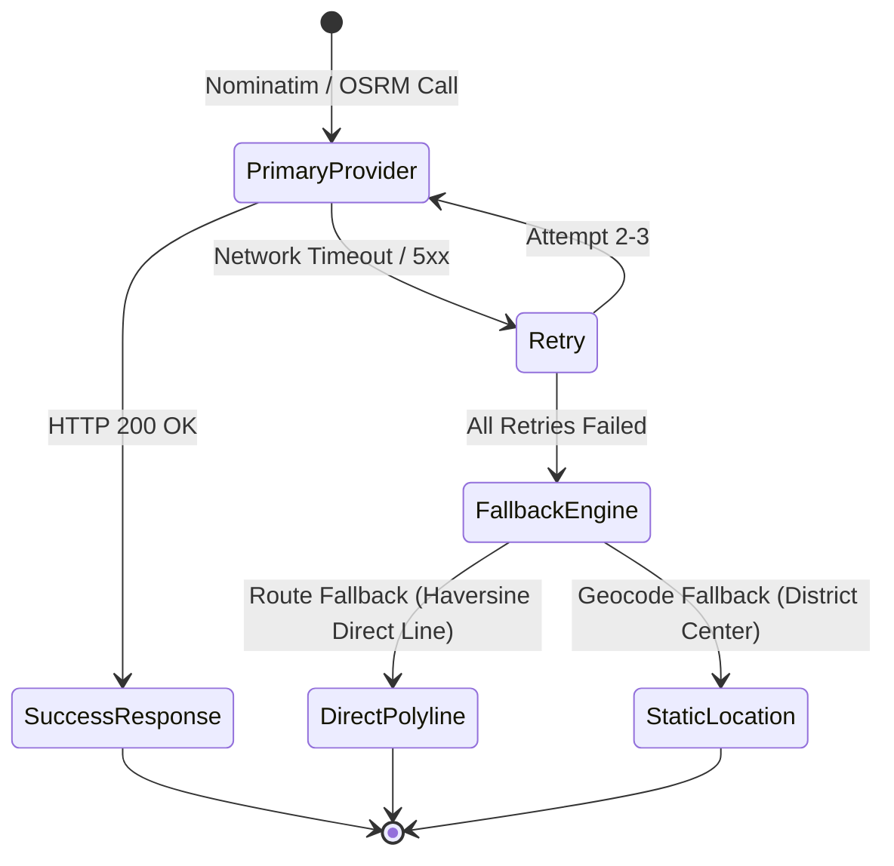

# AgriConnect Location System Architecture (`LOCATION_ARCHITECTURE.md`)

## 1. System Overview

The AgriConnect Location and Geospatial Module is a production-grade, open-source geospatial platform designed to support agricultural employment discovery, distance estimation, turn-by-turn route navigation, and location privacy controls across rural and urban environments.

The architecture decouples the user interface from underlying geospatial data providers, allowing seamless transitions between public free services (Nominatim, OSRM, OpenStreetMap) and high-throughput enterprise self-hosted infrastructure.



---

## 2. Core Architecture Principles

### 2.1 GeoJSON Standard Format
All geospatial coordinates stored in MongoDB follow the **GeoJSON Standard Specification (RFC 7946)**:
- **Structure**: `{ type: "Point", coordinates: [longitude, latitude] }`
- **Longitude First**: Coordinates are ordered as `[lng, lat]` (e.g. `[75.8573, 31.634]`).
- **Spherical Indexing**: Indexes use MongoDB `2dsphere` indexes to calculate accurate distances along the WGS84 curvature.

### 2.2 Data Flow & Request Lifecycle
1. **Frontend Map User Action**: User searches a location, drags map viewport, or requests directions.
2. **Rate Limiting & Input Validation**: `rateLimiter.js` limits requests to 60 req/min per IP. `locationValidator.js` validates coordinates (Lat: `[-90, 90]`, Lng: `[-180, 180]`), radius bounds, and sanitizes input strings to prevent NoSQL injection.
3. **Cache Lookup**: `cacheService.js` checks in-memory cache for recent queries or route polyline keys before making external HTTP requests.
4. **Service Resolution**:
   - Geocoding/Reverse Geocoding requests hit Nominatim with a custom `User-Agent` header.
   - Route Navigation requests query the OSRM driving engine.
   - Distance queries execute Haversine trigonometric calculations.
5. **Privacy Scrubbing & Jittering**: `locationPrivacy.js` filters exact location based on role and privacy settings (`private`, `approximate`, `verified_users`, `public`).
6. **Response Delivery**: Returns sanitized JSON to client.

---

## 3. Distance Math & Reusable Utilities

### 3.1 Haversine Trigonometric Formula
The `calculateDistance()` utility ([`backend/utils/distanceCalculator.js`](file:///e:/Agriconnect/AgriConnect/backend/utils/distanceCalculator.js)) uses the spherical Haversine formula to compute great-circle distances:

\[
a = \sin^2\left(\frac{\Delta\phi}{2}\right) + \cos(\phi_1) \cdot \cos(\phi_2) \cdot \sin^2\left(\frac{\Delta\lambda}{2}\right)
\]
\[
c = 2 \cdot \text{atan2}\left(\sqrt{a}, \sqrt{1-a}\right), \quad d = R \cdot c
\]

Where \( R = 6371 \text{ km} \) (Earth's radius).

### 3.2 Output Schema
```json
{
  "meters": 2800,
  "kilometers": 2.8,
  "miles": 1.7,
  "formatted": "2.8 km away"
}
```

### 3.3 Reusable Entity Distance Functions
- `calculateJobToWorkerDistance(job, workerProfile)`
- `calculateWorkerToJobDistance(workerProfile, job)`
- `calculateFarmerToWorkerDistance(farmerProfile, workerProfile)`
- `calculateUserToJobDistance(userCoords, job)`

---

## 4. Fallback Architecture & Resilience

The location system guarantees high availability using multi-tiered fallback strategy:



1. **Routing Fallback (`calculateRouteService`)**: If OSRM returns `NoRoute` or times out, the service generates a direct polyline between origin and destination, calculating direct Haversine distance and estimated travel time, returning `{ isFallback: true }`.
2. **Geocoding Fallback (`geocodeAddressService`)**: If Nominatim fails or is unreachable, the service falls back to pre-configured regional agricultural district coordinates (e.g. Amritsar center), logging a warning without breaking the frontend application.
3. **Retry Strategy**: HTTP calls use `withRetry()` exponential backoff (up to 3 attempts with 500ms delay).

---

## 5. MongoDB Geospatial Indexing & Query Optimization

MongoDB `2dsphere` indexes are defined on `location` fields in `Job`, `WorkerProfile`, and `FarmerProfile` models:

```javascript
// Job Schema 2dsphere index definition
jobSchema.index({ location: '2dsphere' });
```

### Radial Search Query (`$nearSphere`)
```javascript
const jobs = await Job.find({
  status: 'Active',
  location: {
    $nearSphere: {
      $geometry: {
        type: 'Point',
        coordinates: [longitude, latitude],
      },
      $maxDistance: radiusKm * 1000, // converted to meters
    },
  },
});
```

- **Bounding Box Optimization**: For fast viewport map panning, `$geoWithin` with `$box` coordinates is used to limit document scans to visible map boundaries.
- **Marker Clustering**: Large result sets on the frontend are clustered using Leaflet DivIcon clustering to preserve web render performance.
