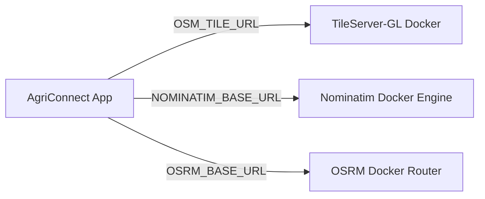

# AgriConnect Location Providers & Migration Guide (`LOCATION_PROVIDERS.md`)

## 1. Provider Technology Stack Overview

AgriConnect relies on an open-source geospatial stack to avoid vendor lock-in and eliminate proprietary map API subscription costs (e.g. Google Maps Platform or Mapbox APIs):

```
┌────────────────────────────────────────────────────────────────────────┐
│                        FRONTEND PRESENTATION                           │
│  Leaflet.js  •  React-Leaflet  •  Tailwind CSS  •  Lucide Icons        │
└───────────────────────────────────┬────────────────────────────────────┘
                                    │
┌───────────────────────────────────▼────────────────────────────────────┐
│                    OPEN-SOURCE PROVIDER INFRASTRUCTURE                 │
│  Tile Server: OpenStreetMap (Raster Tiles)                             │
│  Geocoding Engine: Nominatim OpenStreetMap Search                      │
│  Routing Engine: OSRM (Open Source Routing Machine)                    │
│  Client/Server Math: Turf.js & Haversine Formula                      │
│  Database Storage: MongoDB 2dsphere Geospatial Indexing                │
└────────────────────────────────────────────────────────────────────────┘
```

---

## 2. Detailed Provider Analysis & Public Usage Policies

> [!WARNING]
> **IMPORTANT USAGE POLICY NOTICE**: The public instances of OpenStreetMap, Nominatim, and OSRM used in Phase 8 MVP development are **free community-hosted services** maintained by non-profit organizations. They have strict Acceptable Usage Policies (AUP) and are **not unlimited**.

### 2.1 OpenStreetMap (OSM Tile Server)
- **Role**: Renders map raster tile imagery in Leaflet (`MAP_TILE_URL`).
- **Public Policy**: Max 2 concurrent tile requests per client. No bulk scraping or offline tile downloads.
- **Header Requirements**: `User-Agent` and HTTP `Referer`.

### 2.2 Nominatim Geocoding API
- **Role**: Address-to-coordinate (geocoding), coordinate-to-address (reverse geocoding), and autocomplete search.
- **Public Policy**:
  - **Strict Rate Limit**: Maximum **1 request per second** per IP address.
  - **Custom User-Agent Required**: Must send a valid identifying HTTP `User-Agent` string (configured via `NOMINATIM_USER_AGENT`).
  - **No Bulk Geocoding**: Scraping or bulk address processing is prohibited on the public server.
- **AgriConnect Safeguards**:
  - In-memory caching (`GEOCODING_CACHE_TTL=3600`).
  - Frontend debouncing (300ms minimum delay before searching).
  - Search length guard (minimum 3 characters).

### 2.3 OSRM (Open Source Routing Machine)
- **Role**: Driving distance calculation, travel duration estimation, and polyline route geometry generation.
- **Public Policy**: The demo instance (`https://router.project-osrm.org`) is provided for testing and lightweight demo purposes **without SLA or guaranteed uptime**.
- **AgriConnect Safeguards**:
  - Route result caching (`ROUTE_CACHE_TTL=86400`).
  - Fallback mechanism: Automatically generates a direct Haversine polyline if OSRM fails or times out.

### 2.4 Turf.js & Haversine Math
- **Role**: In-memory client and server geospatial calculations.
- **Performance**: Zero external network overhead; computes distance calculations in <1ms.

### 2.5 MongoDB 2dsphere Geospatial Engine
- **Role**: High-performance spatial indexing on spherical geometry (WGS84).
- **Queries Supported**: `$nearSphere` (radial search), `$geoWithin` (bounding box viewport search).

---

## 3. Migration Guide: Replacing Public Providers with Enterprise Infrastructure

Because all provider URLs are centralized in environment variables ([`locationConfig.js`](file:///e:/Agriconnect/AgriConnect/backend/config/locationConfig.js) & [`locationConfig.ts`](file:///e:/Agriconnect/AgriConnect/src/config/locationConfig.ts)), **you can replace any public provider with self-hosted or commercial managed alternatives without editing any source code**.

### Option A: Self-Hosted Docker Infrastructure (Zero API Fees)



1. **Step 1: Deploy Self-Hosted Tile Server (TileServer-GL / OpenMapTiles)**:
   ```bash
   docker run --name tile-server -d -v $(pwd)/data:/data -p 8080:8080 maptiler/tileserver-gl
   ```
   Set in `.env.production`:
   ```env
   OSM_TILE_URL=https://tiles.yourdomain.com/styles/basic/{z}/{x}/{y}.png
   ```

2. **Step 2: Deploy Self-Hosted Nominatim Container**:
   ```bash
   docker run -d --name nominatim -p 8080:8080 -e PBF_URL=https://download.geofabrik.de/asia/india-latest.osm.pbf mediagis/nominatim:4.4
   ```
   Set in `.env.production`:
   ```env
   NOMINATIM_BASE_URL=https://geocoding.yourdomain.com
   ```

3. **Step 3: Deploy Self-Hosted OSRM Router**:
   ```bash
   docker run -d --name osrm-router -p 5000:5000 -v $(pwd):/data osrm/osrm-backend osrm-routed --algorithm Contracted /data/india-latest.osrm
   ```
   Set in `.env.production`:
   ```env
   OSRM_BASE_URL=https://routing.yourdomain.com
   ```

---

### Option B: Managed Commercial Enterprise Providers

If self-hosting infrastructure is not desired, AgriConnect can be switched to managed commercial providers (e.g., Mapbox, Stadia Maps, LocationIQ) by configuring environment variables:

| Provider | `OSM_TILE_URL` Example | `NOMINATIM_BASE_URL` Example |
| :--- | :--- | :--- |
| **LocationIQ** | `https://{s}-tiles.locationiq.com/v3/streets/r/{z}/{x}/{y}.png?key=TOKEN` | `https://us1.locationiq.com/v1` |
| **Stadia Maps** | `https://tiles.stadiamaps.com/tiles/alidade_smooth/{z}/{x}/{y}{r}.png?api_key=KEY` | N/A |
| **Mapbox** | `https://api.mapbox.com/styles/v1/mapbox/streets-v11/tiles/{z}/{x}/{y}?access_token=TOKEN` | N/A |

Simply set the respective environment variable in your production environment!
