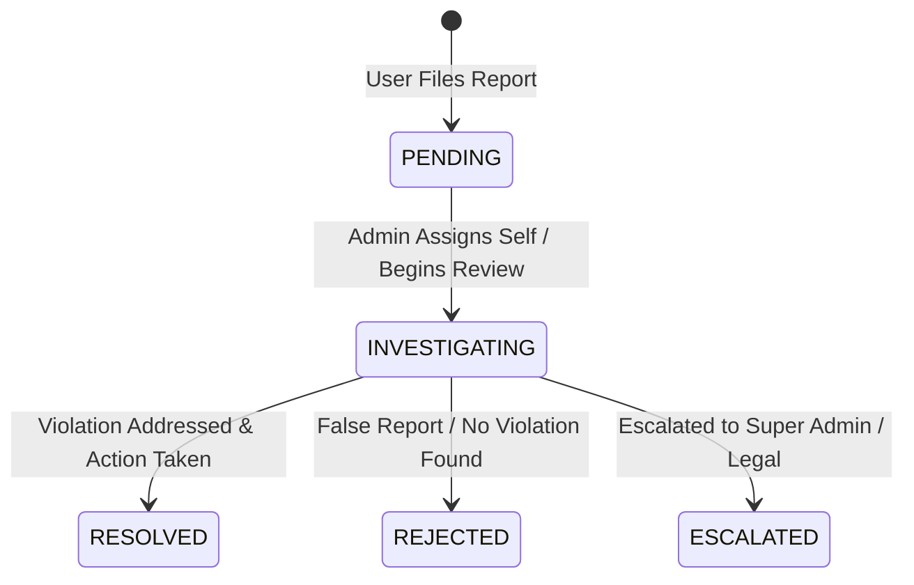

# Reports, Disputes & Complaints Administration

## Report Categories & Priority Assignment

Users can submit complaints across 10 categories:
1. `USER`
2. `JOB`
3. `APPLICATION`
4. `CERTIFICATE`
5. `VERIFICATION_ABUSE` (Auto-Assigned `HIGH` Priority)
6. `FRAUD` (Auto-Assigned `HIGH` Priority)
7. `SPAM`
8. `HARASSMENT` (Auto-Assigned `HIGH` Priority)
9. `SUSPICIOUS_PROFILE`
10. `OTHER`

---

## Status Workflow

---

## Confidential Internal Admin Notes

- Admins can add internal investigation notes (`internalNotes`).
- `internalNotes` are marked `{ select: false }` in Mongoose and are **never exposed** to end users or API clients.
